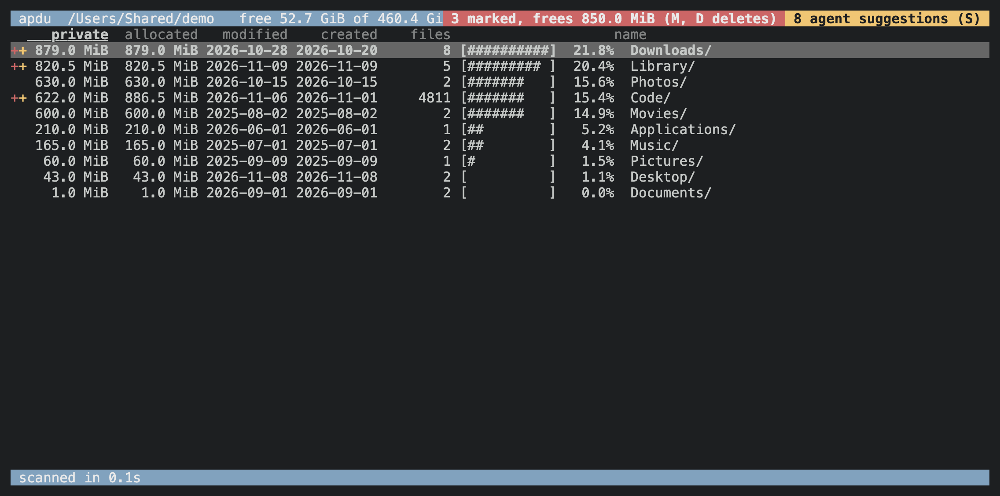
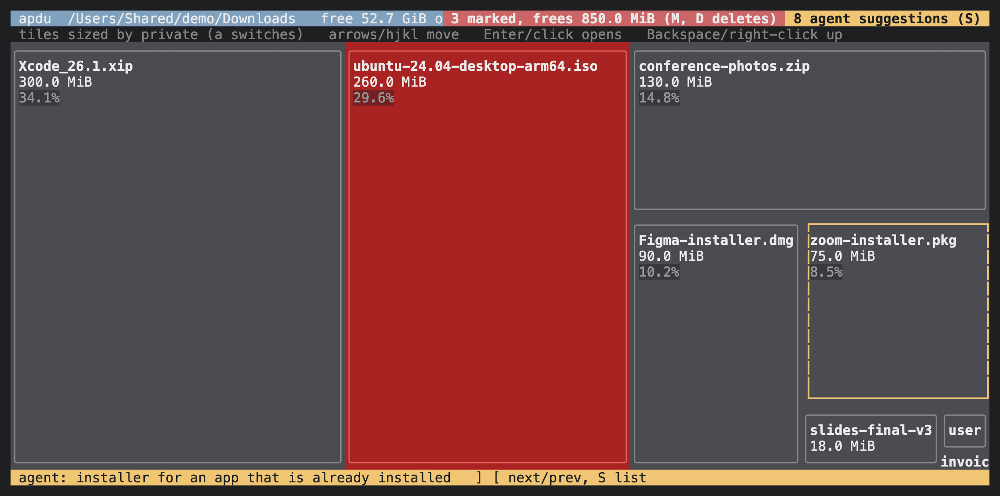
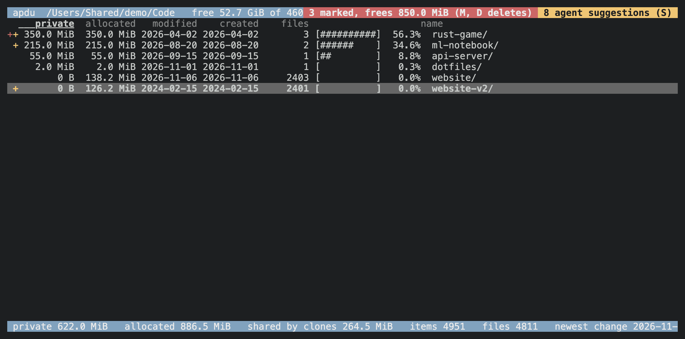
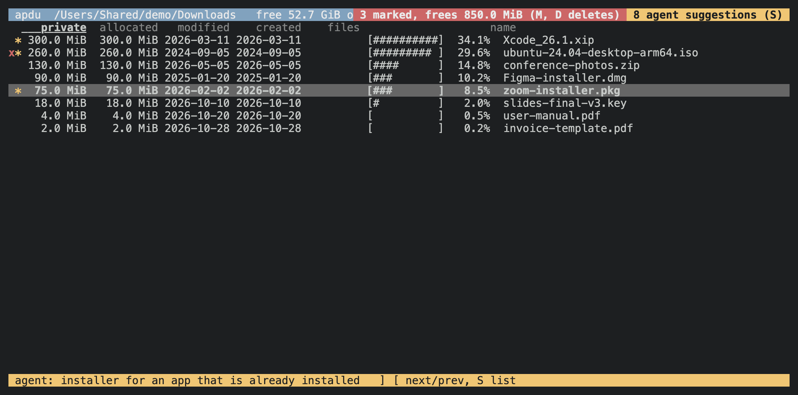
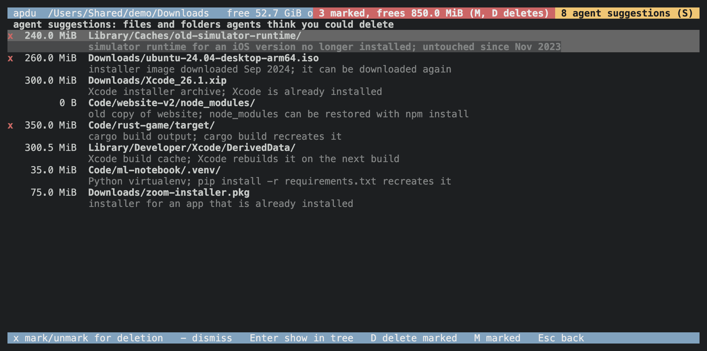

# apdu

A disk usage browser for macOS, like ncdu, that understands APFS copy-on-write clones. It shows how much space deleting something would actually free, not just what `du` reports.



*The browser. `private` is what deleting an entry would free; `allocated` is what `du` would count.*

## Prerequisites

- macOS (it uses APFS and FSEvents).
- Git.
- Rust 1.88 or newer. Check with `cargo --version`.

If `cargo` isn't on your `PATH`, install Rust with [rustup](https://rustup.rs).

## Install

```sh
cargo install --git https://github.com/timkrins/apdu
```

This builds apdu and puts it in `~/.cargo/bin`, which rustup adds to your `PATH`, so `apdu` runs from any folder. Check with `apdu --help`.

## Update

Run the same command again:

```sh
cargo install --git https://github.com/timkrins/apdu
```

Cargo rebuilds when there's a new commit on `main`, and says "already installed" when there isn't. To reinstall anyway, add `--force`.

## Uninstall

```sh
cargo uninstall apdu
rm -rf ~/Library/Caches/apdu
```

The second line removes saved scans, agent suggestions and deletion marks. If you used the MCP server, also remove its token:

```sh
rm -rf ~/Library/Application\ Support/apdu
```

## Usage

```sh
apdu                    # browse the current folder
apdu ~/Code             # browse a folder
apdu --print 10 ~       # print the 10 biggest children and exit
apdu --no-cache /       # rescan everything instead of reusing the last scan
```

In the browser, press `?` for keys. `d` deletes (it asks first), `s` sorts by size, `f` by how many files a folder holds (counted all the way down, shown in the files column), `t` opens a treemap, `q` quits.



*The treemap (`t`), with tiles sized by private space. Items marked for deletion are red.*



*`website-v2` is an APFS clone of `website`: 126 MiB allocated, but deleting it frees nothing.*
While a delete runs, a box shows how many items and bytes are gone so far and which folder it is in. It closes when the delete is done.
`r` rescans the folder on screen in the background: a box shows how many items it has found, the folder it is in and how long it has taken, and closes when the rescan is done. `q` still quits meanwhile.

### Mark now, delete later

Instead of deleting straight away, press `x` to mark a file or folder for deletion. Press `x` again to unmark it. Marked items get a red `x`, and folders holding marks get a red `+`. The header shows how many items are marked and how much private space deleting them would free. Marks are kept between runs.

- `M` lists everything marked. `x` there unmarks an item, and `Enter` shows it in the tree.
- `D` deletes everything marked. It lists what it will delete and the total, and asks first.

From the shell, with no TUI needed:

```sh
apdu marked                 # list everything marked, in every folder
apdu delete-marked          # delete it all (asks first)
apdu delete-marked --yes    # delete it all without asking
```

A TUI that is already running keeps showing the old sizes after `delete-marked`. Press `r` there to rescan.

### Agents

Agents can drive a running apdu over a local socket, for example:

```sh
apdu sizes ~/Library --children 10
apdu find node_modules ~/Code       # every node_modules in the scan, biggest first
apdu suggest ~/Library/Caches/old-thing "not touched since 2024"
```

Agents can't delete or mark anything. Their suggestions show in the TUI: `]` and `[` step through them, and `S` opens a page listing each suggested file or folder with its reason and size. On that page, `x` marks one for deletion and `-` dismisses it.



*Stepping to a suggestion with `]`: the agent's reason shows in the footer.*



*The suggestions page (`S`), with three suggestions marked for deletion.*

When you delete a suggested item, apdu remembers that, and `apdu suggestions` lists it under `deleted` with the date. Agents can then tell it's gone and won't suggest it again. If the path comes back, it drops off that list.

`apdu --help` lists every option and agent command.

### MCP server

apdu can also serve [MCP](https://modelcontextprotocol.io), so agents can browse what it has scanned and suggest deletions. It's off by default. To turn it on, start the TUI with `--mcp`:

```sh
apdu --mcp ~                # serves http://127.0.0.1:7377/mcp
apdu --mcp-lan ~            # the same on every interface, for other machines on your network
apdu --mcp-port 8000 ~      # another port (implies --mcp)
```

The server runs inside the TUI and uses that TUI's scan. The header shows `MCP` while it's on. Only one TUI can hold the port, so a second one started with `--mcp` runs without it and says so. The tools are `sizes`, `find`, `suggest`, `suggestions`, `clear_suggestion` and `goto`, the same as the agent commands. `find` searches the whole scan for a name, such as `node_modules` or `*.log`, in one call. Suggestions made over MCP go into the same saved list as `apdu suggest`.

Every request needs a bearer token. apdu makes one on first use and keeps it, readable only by you, in `~/Library/Application Support/apdu/mcp-token`. Delete that file to get a new one. To add the server to Claude Code:

```sh
claude mcp add --transport http apdu http://127.0.0.1:7377/mcp \
  --header "Authorization: Bearer $(cat ~/Library/Application\ Support/apdu/mcp-token)"
```

#### Pairing another computer

Rather than copying the token by hand, press `P` in the TUI. A box shows a command to type on the other computer, for example:

```sh
curl -fsS http://your-mac.local:7377/pair/482913 | sh
```

It also shows the same command with this Mac's IP address, for networks where `.local` names don't resolve. The command adds apdu to Claude Code on that computer (user scope). Without Claude Code, it prints the URL and token for another MCP client. The box stays up until a computer pairs, then closes and says which address paired.

Pairing is off until you press `P`. The code is six digits and works once. It expires after three minutes, after five wrong guesses, or when you close the box with any key. With plain `--mcp`, pairing works only from this Mac.

You can also set up another computer by hand, using the URL the TUI shows when it starts (for example `http://your-mac.local:7377/mcp`) and the same token. `--mcp-lan` uses plain HTTP, so anyone on the network can read the token in transit. Only use it on a network you trust, and quit the TUI when you're done.

## Licence

MIT. See [LICENSE](LICENSE).
